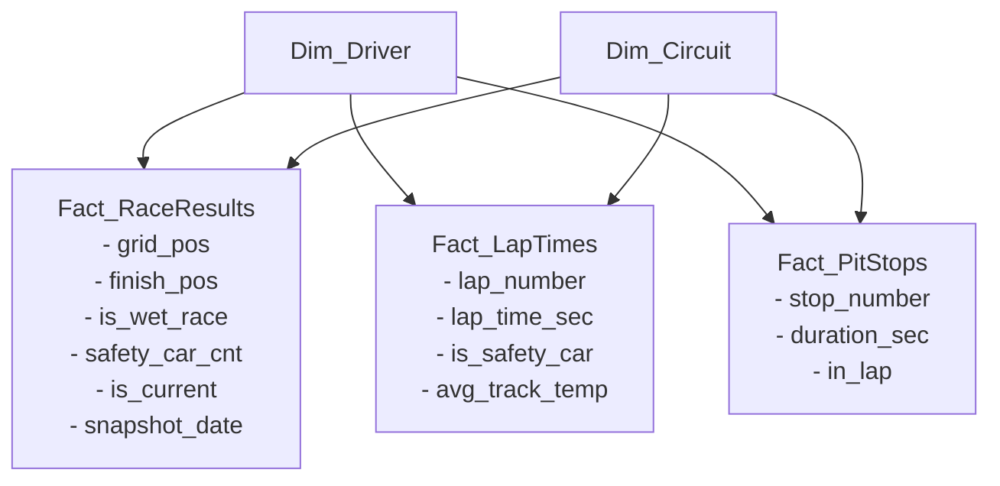

# Projekt: F1 BI Rendszer (Üzleti Intelligencia Házi Feladat)

## 1. Architektúra és Célok
- **Cél:** Teljes életciklusú BI rendszer Formula–1 adatokkal, megajánlott jegy célkitűzéssel.
- **ETL:** Low-code adatbetöltés (Pentaho PDI / n8n tervezve), automatizált, növekményes (delta) és csúszóablakos (sliding window) frissítéssel.
- **DWH:** PostgreSQL relációs adatbázis, Galaxy/Constellation csillagséma.
- **BI / Megjelenítés:** Power BI Desktop (összetett DAX mérőszámok, track affinity, steward audit trail).

## 2. Adatforrások
- **Jolpica-F1 REST API** (`https://api.jolpica.com/ergast/f1/`): Történelmi és futameredmények, köridők, rajtpozíciók, bokszkiállások.
- **OpenF1 API** (`https://api.openf1.org/v1/`): Telemetria, Safety Car fázisok (`/race_control`), pálya- és időjárásadatok (`/weather`).

## 3. Tervezett Adatbázis-séma (PostgreSQL)
- **Dimenziók:** `Dim_Driver`, `Dim_Constructor`, `Dim_Circuit`, `Dim_Season`, `Dim_Weather`.
- **Ténytáblák:** 
  - `Fact_RaceResults` (tartalmazza a grid/finish pozíciót, esős futam jelzőt, valamint audit trail / verziózást az utólagos FIA büntetések követésére: `is_current`, `snapshot_date`).
  - `Fact_LapTimes` (köridők másodpercben, `is_safety_car` flaggel ellátva).
  - `Fact_PitStops` (kiállások időtartama, kerékcsere ideje).

## 4. Főbb Elemzési Fókuszok (DAX & SQL)
- Időmérő determináltsága: Pályánkénti rajtpozíció-megtartás és győzelmi konverzió (grid vs. finish).
- Safety Car és extrém időjárás hatása a versenydinamikára és kiesésekre (DNF).
- Bokszkiállási konzisztencia csapatonként és a pozícióvesztés esélye elrontott csere esetén.
- "Zöld asztal melletti döntések": leintéskori sorrend vs. hivatalos FIA végeredmény eltéréseinek történeti elemzése.

## 5. Adatbázis Koncepció (Galaxy / Constellation Csillagséma)

A rendszer több ténytáblára épül, amelyek közös dimenziókon (pilóták, csapatok, pályák) osztoznak:

Főbb funkciók az ábra alapján:
- Fact_RaceResults: Rajthely vs. befutó elemzése, esős futamok és az utólagos FIA módosítások verziózása (is_current, snapshot_date).
- Fact_LapTimes: Tiszta versenytempó vizsgálata a Safety Car körök kiszűrésével (is_safety_car).
- Fact_PitStops: Bokszkiállási idők, csapatkonzisztencia és kerékcsere-stratégiák.

## 6. API Adatlefedettség (Postmannel tesztelve)

A `MRData.total` mező alapján ellenőrzött első elérhető szezonok:

| Adat | Első szezon | Forrás |
|---|---|---|
| Futameredmények, naptár, pilóták, csapatok, pályák, bajnoki állások | 1950 | Jolpica |
| Időmérő (qualifying) | 1995 | Jolpica |
| Köridők (laps) | 1996 | Jolpica |
| Bokszkiállások (pitstops) | 2011 | Jolpica |
| Időjárás (`/weather`), Safety Car (`/race_control`), gumikopás/stintek (`/stints`) | 2023 | OpenF1 |

- A Jolpica tesztelve van; az OpenF1 2023 előtti szezonokra nem ad adatot.
- A működő Jolpica host: `https://api.jolpi.ca/ergast/f1/` (a fenti `api.jolpica.com` helyett).
- Jolpica: minden érték string (típuskonverzió kell), alapértelmezett `limit=30`, maximum 100, `offset` lapozás. Nincs "last modified" mező.
- A 2023 előtti szezonoknál az `is_wet_race`, `safety_car_cnt`, `is_safety_car`, `avg_track_temp` értéke `NULL` (nem `false`/`0`), a riportokban jelezni kell, hogy az adat csak 2023-tól elérhető. Erre egy `data_coverage` tábla szolgál (adatkör, első szezon).

## 7. Tervezési döntések (eddig)

- **Gerinc:** a Jolpica az elsődleges forrás (azonosítók, naptár); az OpenF1 csak kiegészítő (időjárás, Safety Car, stintek).
- **Összekapcsolás:**
  - Futam ↔ OpenF1 session: Jolpica `date` = OpenF1 `date_start` dátumrésze (`session_name='Race'`, azonos `year`); az `openf1_session_key` a `Dim_Race` táblában tárolt.
  - Pálya: az OpenF1 `circuit_key` a `Dim_Circuit.openf1_circuit_key`.
  - Pilóta: 3 betűs kód (Jolpica `code` ↔ OpenF1 `name_acronym`) + szezon. A `permanentNumber` nem használható (pl. Verstappen: permanentNumber 3, de 1-es rajtszámmal versenyzett).
  - Csapat: csak a Jolpica `constructorId`.
- **Séma kiegészítések:** `Dim_Race` (season, round, date, circuit, openf1_session_key) és `Dim_Constructor` kell; a ténytáblák a `Dim_Race`-hez is kapcsolódnak.
- **Csapatnevek:** két réteg: constructor (Jolpica `constructorId`-nként egy sor) + franchise/lineage tábla alias-okkal (`valid_from_season`, `valid_to_season`). A kozmetikai átnevezések (szponzor) egy franchise-hoz tartoznak; a tulajdonosváltások (pl. Tyrrell → BAR → Honda → Brawn → Mercedes) esetén eseti döntés.
- **Staging réteg:** végpontonként egy staging tábla (nyers `jsonb` + `season`, `round`, `source_url`, `load_ts`, `run_id`), append-only; a feldolgozás SQL-ben külön lépés. `etl_run_log` tábla a futások naplózására és a folytatható betöltéshez.
- **ETL jobok (Pentaho, paraméterezett: `SEASON`, `ROUND`):**
  - **Job A (szezonális):** szezon kezdetén naptár, csapatok, pilóták, pályák, OpenF1 session-ök (`openf1_session_key` feltöltése); szezon végén végső bajnoki állások.
  - **Job B (futamhétvége):** eredmények, időmérő, köridők, bokszkiállások (Jolpica) + időjárás, race_control, stintek (OpenF1). Futam utáni 1-2. napon fut, és az utolsó N futam eredményét újratölti (csúszóablak), az FIA-büntetések követéséhez (`is_current`, `snapshot_date`).
  - A kezdeti feltöltés (backfill) ugyanezek a jobok egy szezon/forduló ciklusban; az egész legyen folytatható. A rate limiteket tiszteletben kell tartani.
  - Ütemezés: Kitchen parancssorból (Windows Task Scheduler / cron).
- **Audit trail korlát:** az `is_current`/`snapshot_date` csak az első betöltés utáni módosításokat tudja követni.
- **Állapot:** a PostgreSQL docker konténer (`db/docker-compose.yml`) kész és fut; a séma még nincs létrehozva.
- **Nyitott kérdés:** a backfill kezdete: 1996-tól minden (javasolt), vagy az eredmények 1950-től, a többi adat a saját kezdőévétől.

## 8. Döntés és séma állapota

- **Backfill:** a Jolpica CSV dumpból a teljes történeti állomány **1950-től** betöltődik (konstruktőri állások 1958-tól, időmérő 1994-től, köridők 1996-tól, bokszkiállások 2011-től); a 2023 előtti időjárás/Safety Car mezők `NULL`-ok maradnak.
- **Séma:** `db/init/01_schema.sql` (a `db/docker-compose.yml` az `./init` mappát a `/docker-entrypoint-initdb.d`-be csatolja; csak üres adatkötetnél fut le automatikusan).
  - `etl` séma: `run_log`, `data_coverage` (a 6. fejezet adataival feltöltve).
  - `stg` séma: végpontonként egy nyers `jsonb` tábla (`jolpica_*`, `openf1_*`).
  - `dwh` séma: `dim_driver`, `dim_franchise`, `dim_constructor`, `dim_constructor_alias`, `dim_circuit`, `dim_season`, `dim_race`, `dim_weather`; `fact_race_results` (verziózott: `is_current`, `snapshot_date`), `fact_qualifying`, `fact_lap_times`, `fact_pit_stops`.
- **Következő lépések:** Pentaho extrakciós jobok (staging betöltés) → SQL transzformációk staging → dwh → Power BI.

## 9. ETL jobok (Pentaho) és a projekt jelenlegi állapota

### Fájlok
- `db/docker-compose.yml`: PostgreSQL 16 konténer (`formulabi-postgres`, port 5432, adatbázis/felhasználó/jelszó: `formulabi`).
- `db/init/01_schema.sql`: `etl`, `stg`, `dwh` sémák (lásd 8. fejezet).
- `db/init/02_dump_schema.sql`: a Jolpica CSV adatbázis-dump 13 nyers `stg.dump_*` táblája, a `stg.v_dump_race_entry` nézet, valamint az időtartamokat oda-vissza konvertáló `etl.format_duration` és `etl.parse_duration_sec` függvények.
- `db/transform/`: staging → dimenzió (`dim_*.sql`) és staging → ténytábla (`fact_*.sql`) SQL scriptek, valamint a dump táblákból mind a 9 Jolpica staging táblába API-formátumú JSONB sorokat építő `stg_from_dump.sql`.
- `data/jolpica_dump/`: a letöltött és kicsomagolt Jolpica CSV dump (`jolpica-f1-csv.zip`, `formula_one_*.csv`).
- `etl/` mappa: a Pentaho (PDI/Spoon) fájlok; `progress.md`: haladási napló.

### Pentaho beállítások
- PostgreSQL JDBC `.jar` a `data-integration/lib/` mappában.
- Megosztott kapcsolat: `formulabi_pg` (localhost:5432, `formulabi`), az **Options** fülön `stringtype = unspecified`, hogy a Table Output szöveget tudjon `jsonb` oszlopba írni.

### Elkészült jobok
**`etl/job_load_races.kjb`**: a futamnaptár betöltése a staging rétegbe, 1996-tól az aktuális évig.
1. `tr_list_seasons.ktr`: Table Input (`generate_series(1996, aktuális év)`, a már betöltött szezonok kihagyásával, de mindig belevéve az aktuális szezont és a még le nem zárt világbajnokú szezonokat, amennyiben aznap még nem frissültek API-ról) → Select values (`#` formátummaszk) → Copy rows to result. Így a job újraindítható és a heti futásoknál is frissíti az aktuális szezont.
2. `tr_load_races_season.ktr` (paraméter: `SEASON`), szezononként egyszer fut (*Execute for every input row*): Get Variables (`season`, `url`) → HTTP Client (`https://api.jolpi.ca/ergast/f1/${SEASON}/races.json?limit=100`, eredmény: `payload`, státusz: `status_code`) → Filter rows (`status_code = 200`; hamis ág: Abort) → Delay row (1 mp, rate limit) → Table Output (`stg.jolpica_races`: `season`, `source_url`, `payload`).

A szezononkénti naptár egy kérésben elfér (legfeljebb ~24 futam), lapozás nem kell.

**`etl/job_load_season_dims.kjb`**: pilóták, csapatok és bajnoki végeredmények (`driverstandings`, `constructorstandings`) betöltése szezononként a staging rétegbe (1996-tól).
1. `tr_list_seasons.ktr` (paraméterek: `ENDPOINT`, `TARGET_TABLE`): az `stg.${TARGET_TABLE}` táblából hiányzó szezonok, valamint az aktuális (és még nem lezárt bajnokú) szezon listája, `Select values` lépéssel (`#` formátummaszk a `season` mezőre).
2. `tr_load_endpoint_season.ktr` (paraméterek: `SEASON`, `ENDPOINT`, `TARGET_TABLE`): a `tr_load_races_season` általánosított változata. URL: `https://api.jolpi.ca/ergast/f1/${SEASON}/${ENDPOINT}.json?limit=100`; a Table Output a céltáblát a `target_table` mezőből (`${TARGET_TABLE}`) veszi, mivel a bajnoki állásoknál az API végpont (`driverstandings`, `constructorstandings`) és a táblanév (`jolpica_driver_standings`, `jolpica_constructor_standings`) eltér egy aláhúzásjelben.
3. A job sorrendje: Start → List/Download (drivers) → List/Download (constructors) → List/Download (driver standings) → List/Download (constructor standings) → Success.
A futamhétvégék (naptár, pálya) adatait nem kellett újra betölteni, mert a `stg.jolpica_races` payload tartalmazza a pályák adatait is, így a `jolpica_circuits` végpont sem szükséges.

**`etl/job_load_round_data.kjb`**: az eredmények, az időmérő és a bokszkiállások betöltése fordulónként a staging rétegbe.
1. `tr_list_rounds.ktr` (paraméterek: `ENDPOINT`, `FIRST_SEASON`): Table Input a `dwh.dim_race` táblából (`race_date < current_date`), kihagyva azokat a fordulókat, amelyek már szerepelnek a `stg.jolpica_${ENDPOINT}` táblában (`NOT EXISTS`), kivéve a `results` végpontnál az elmúlt 21 nap futamait (csúszóablakos újratöltés az utólagos FIA-büntetések követésére, napi egyszeri letöltési védelemmel). Az eredmény a *Copy rows to result* lépéssel kerül tovább (`season`, `round`).
2. `tr_load_endpoint_round.ktr` (paraméterek: `SEASON`, `ROUND`, `ENDPOINT`, `DELAY_SECONDS`): a `tr_load_endpoint_season` fordulós változata. URL: `https://api.jolpi.ca/ergast/f1/${SEASON}/${ROUND}/${ENDPOINT}.json?limit=100`; a Delay row ideje `${DELAY_SECONDS}`; a Table Output a `season`, `round`, `source_url`, `payload` oszlopokat tölti.
3. A job sorrendje: List (results, 1996-tól) → Download results → List (qualifying, 1996-tól) → Download qualifying → List (pitstops, 2011-től) → Download pitstops → Success. A Download bejegyzések *Execute for every input row* módban futnak, a `SEASON` és `ROUND` paramétereket a **Parameters** fülön a *Stream column name* oszlopból (`season`, `round`) kapják; a *Copy previous results to parameters* önmagában nem elég. A kapcsolatok feltételesek (*Follow when result is true*), hogy a hiba megállítsa a jobot.
4. Rate limit: 429-es válasznál (Cloudflare 1015) a Filter rows lépés megszakítja a transzformációt; a következő futás ott folytatja, ahol abbamaradt. A megtalált órás limit kb. 500 kérés, ezért `DELAY_SECONDS = 8` (kb. 450 kérés/óra). A pitstops lekérdezés `limit=100` miatt egy forduló legfeljebb 100 kiállást tartalmazhat; ez eddig minden fordulónál elég volt.

**Teljes történeti Jolpica backfill CSV dumpból (`etl/job_load_dump.kjb`)**: a Jolpica ingyenes (14 napos késleltetésű) CSV adatbázis-dumpjából tölti fel az összes `stg.jolpica_*` táblát **1950-től** kezdődően, így egy üres adatbázis inicializálásakor nem kell több ezer API kérést indítani.
- Letölti és kicsomagolja a CSV dumpot a `data/jolpica_dump/` mappába, lefuttatja a `db/init/02_dump_schema.sql` scriptet, majd a `tr_load_dump_csv.ktr` transzformációval (`TRUNCATE` + `INSERT`) betölti a 13 szükséges CSV-t az `stg.dump_*` táblákba (`season`, `round`, `circuit`, `session`, `sessionentry`, `roundentry`, `teamdriver`, `driver`, `team`, `driverchampionship`, `teamchampionship`, `lap`, `pitstop`).
- Végül a `db/transform/stg_from_dump.sql` a nyers dump táblákból az API-válaszokkal megegyező JSONB szerkezetű sorokat épít mind a 9 Jolpica staging táblába (`jolpica_races`, `jolpica_drivers`, `jolpica_constructors`, `jolpica_driver_standings` 1950-től, `jolpica_constructor_standings` 1958-tól, `jolpica_results` 1950-től, `jolpica_qualifying` 1994-től, `jolpica_laps` 1996-tól, `jolpica_pitstops` 2011-től), kihagyva a már betöltött szezonokat/fordulókat (`WHERE NOT EXISTS`).

**Köridők növekményes betöltése API-ról (`etl/job_load_laps.kjb`)**: a dumpból még hiányzó legfrissebb fordulók pótlására (2023-tól). Egy forduló kb. 1000–1400 köridőt tartalmaz, ami több oldal (`limit=100`, `offset`), ezért két szint kellett. Az oldalszám a `limit` miatt a köridő-rekordokat számolja, nem a köröket, így egy kör két oldalra is eshet; a transzformáció során deduplikálni kell `(forduló, kör, pilóta)` alapján.
- `tr_laps_total.ktr` (paraméterek: `SEASON`, `ROUND`, `DELAY_SECONDS`): `limit=1` kérés → Filter rows (200, különben Abort) → Delay row → JSON input (`$.MRData.total`) → Select values (`season`, `round`, `total`; `#` formátummaszkkal, hogy a paraméterátadásnál ne legyen vezető szóköz/nulla) → Copy rows to result.
- `tr_load_laps_pages.ktr` (paraméterek: `SEASON`, `ROUND`, `TOTAL`, `DELAY_SECONDS`): Table Input (`generate_series(0, TOTAL - 1, 100)` → oldalankénti URL) → HTTP client → Filter rows (200, különben Abort) → Delay row → Table Output (`stg.jolpica_laps`: `season`, `round`, `source_url`, `payload`).
- `job_load_laps_round.kjb` (paraméterek: `SEASON`, `ROUND`, `DELAY_SECONDS`): SQL (`DELETE FROM stg.jolpica_laps` az adott fordulóra, a félbemaradt betöltések törlésére) → Laps total → Laps pages (*Execute for every input row*, a `SEASON`, `ROUND`, `TOTAL` a result sorból) → Success.
- `job_load_laps.kjb` (paraméter: `DELAY_SECONDS`): `tr_list_rounds` (`ENDPOINT = laps`, `FIRST_SEASON = 2023`) → `job_load_laps_round` fordulónként → Success.

**OpenF1 adatok betöltése (`etl/job_load_openf1.kjb`)**: a 2023-tól elérhető OpenF1 adatok (`sessions`, `weather`, `race_control`, `stints`, `drivers`) betöltése a staging rétegbe és a `dim_race` / `dim_circuit` OpenF1 azonosítóinak feltöltése (`DELAY_SECONDS = 3`).
- `tr_list_openf1_seasons.ktr` → `tr_load_openf1_sessions.ktr`: a `dwh.dim_race` alapján listázza azokat a 2023 utáni szezonokat, ahol van lezajlott futam `openf1_session_key` nélkül, majd letölti a `https://api.openf1.org/v1/sessions?year=${SEASON}&session_name=Race` végpontot az `stg.openf1_sessions` táblába.
- `db/transform/dim_openf1_session.sql`: az `stg.openf1_sessions` JSON tömbjéből (`session_name = 'Race'`) kitölti a `dwh.dim_race.openf1_session_key` oszlopot (`abs(race_date - session_date) <= 1`, hogy a helyi idő szerint szombat esti Las Vegas-i futamok UTC dátuma is illeszkedjen), valamint a `dwh.dim_circuit.openf1_circuit_key` oszlopot.
- `tr_list_openf1_sessions.ktr` (paraméter: `ENDPOINT`) → `tr_load_openf1_endpoint.ktr` (paraméterek: `SEASON`, `ROUND`, `SESSION_KEY`, `ENDPOINT`, `DELAY_SECONDS`): a lezajlott, `openf1_session_key`-jel rendelkező futamokra letölti a `https://api.openf1.org/v1/${ENDPOINT}?session_key=${SESSION_KEY}` végpontot az `stg.openf1_${ENDPOINT}` táblába (`weather`, `race_control`, `stints`, `drivers`). A `Select values` lépés `#` formátummaszkot állít be az egész számokra (`season`, `round`, `session_key`), hogy a paraméterátadásnál ne kerüljön szóköz vagy ezreselválasztó az URL-be.

**DWH dimenziók és ténytáblák betöltése (`etl/job_transform_dims.kjb`, `etl/job_transform_facts.kjb`)**: a staging táblákból idempotens SQL scriptekkel (`db/transform/*.sql`) tölti fel a teljes csillagsémát.
- `job_transform_dims.kjb`: sorban lefuttatja a `dim_driver.sql`, `dim_constructor.sql`, `dim_franchise.sql` (`dim_franchise`, `dim_constructor.franchise_key` és `dim_constructor_alias` feltöltése sziget-algoritmussal, 1950-től kezdődő jogelőd- és karosszéria-motor-összevonásokkal, valamint szponzornevekkel), `dim_season.sql` (a lezárt szezonok egyéni és konstruktőri világbajnokainak beállításával), `dim_circuit.sql`, `dim_race.sql`, `dim_openf1_session.sql` és `dim_weather.sql` scripteket.
- `job_transform_facts.kjb`: sorban lefuttatja a `fact_qualifying.sql`, `fact_race_results.sql` (SCD Type 2 verziózással az `is_current` és `snapshot_date` mezőkön, valamint az OpenF1 időjárás és Safety Car adatokkal), `fact_pit_stops.sql` (a csapatot a `fact_race_results` táblából hozzákapcsolva) és `fact_lap_times.sql` (a lapozott API sorok deduplikálásával, Safety Car körök és pályahőmérséklet jelölésével) scripteket. Az időtartam-szövegeket az `etl.parse_duration_sec` függvény alakítja másodpercekké (`NUMERIC(8, 3)`).

**Fő vezérlő (orchestrator) jobok (`etl/job_weekly_update.kjb`, `etl/job_init_all.kjb`)**:
- `job_weekly_update.kjb`: a rendszeresen (hetente keddenként) futó frissítő job. Sorrendje: `job_load_races` → `job_load_season_dims` → `job_transform_dims` → `job_load_round_data` → `job_load_laps` → `job_load_openf1` → `job_transform_dims` (az új időjárás- és világbajnok-adatok átvezetésére) → `job_transform_facts`.
- `job_init_all.kjb`: egy teljesen üres adatbázis egyszeri inicializáló jobja. Először lefuttatja a `job_load_dump` jobot (betöltve az 1950-től elérhető teljes Jolpica történetet a 14 napos késleltetésű CSV dumpból), majd meghívja a `job_weekly_update` jobot, amely pótolja az elmúlt 14 nap Jolpica adatait az API-ról, letölti a 2023 utáni OpenF1 adatokat, és feltölti az összes `dwh` dimenzió- és ténytáblát.

### Jelenlegi állapot (2026-11-04)
- A docker konténer és a séma működik.
- A teljes történeti (1950–2026) Jolpica CSV dump betöltés (`job_load_dump`), az API alapú növekményes és csúszóablakos betöltések (`job_load_races`, `job_load_season_dims`, `job_load_round_data`, `job_load_laps`, `job_load_openf1`), a DWH transzformációk (`job_transform_dims`, `job_transform_facts`), valamint a két fő vezérlő job (`job_init_all`, `job_weekly_update`) elkészült.
- A `dwh` csillagséma összes dimenzió- és ténytáblája 1950-től napjainkig (a 2026-os 18. fordulóig bezárólag) fel van töltve.
- A Power BI riport és a heti automatikus ütemezés még nem készült el.

### Következő lépések
1. A `job_weekly_update.kjb` heti (keddenkénti) automatikus futtatásának beállítása (Kitchen + Windows Task Scheduler).
2. Power BI riport elkészítése a feltöltött `dwh` csillagséma alapján (DAX mérőszámok, elemzési fókuszok).
